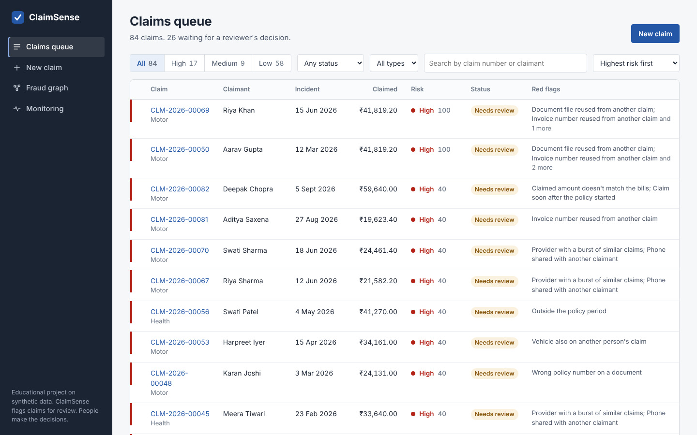
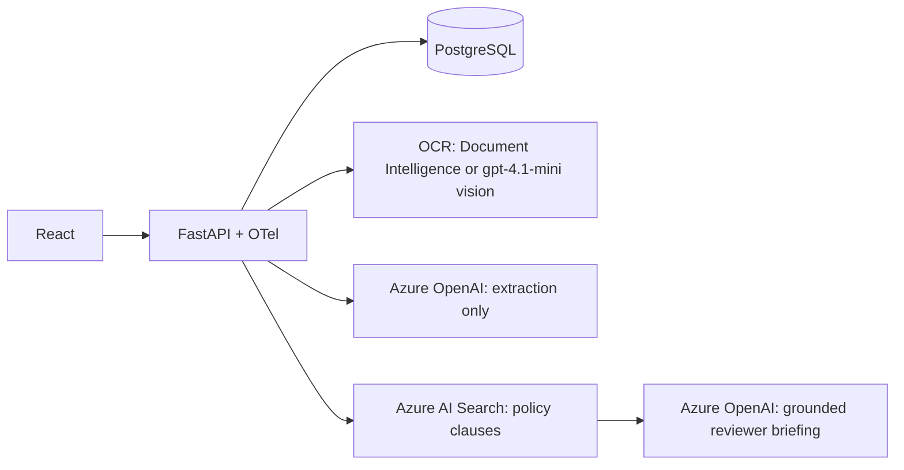
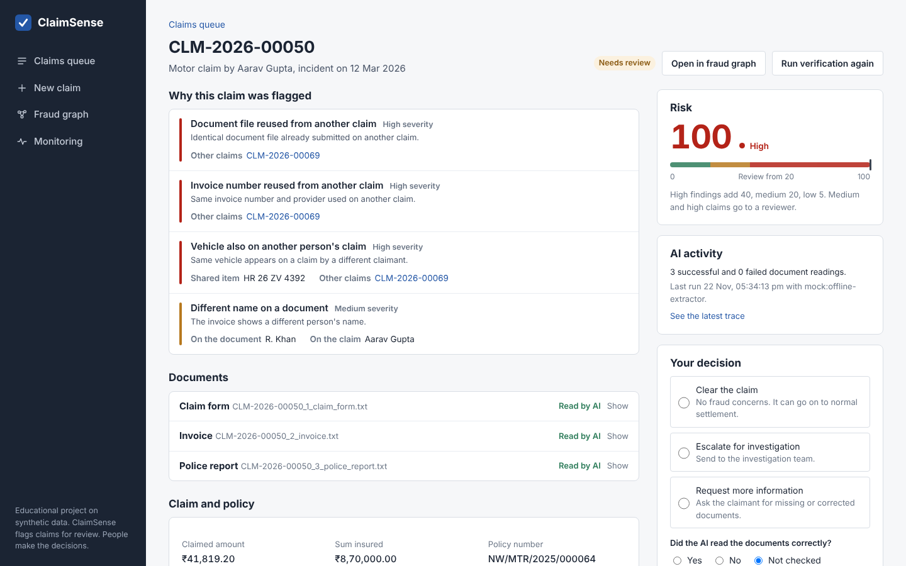
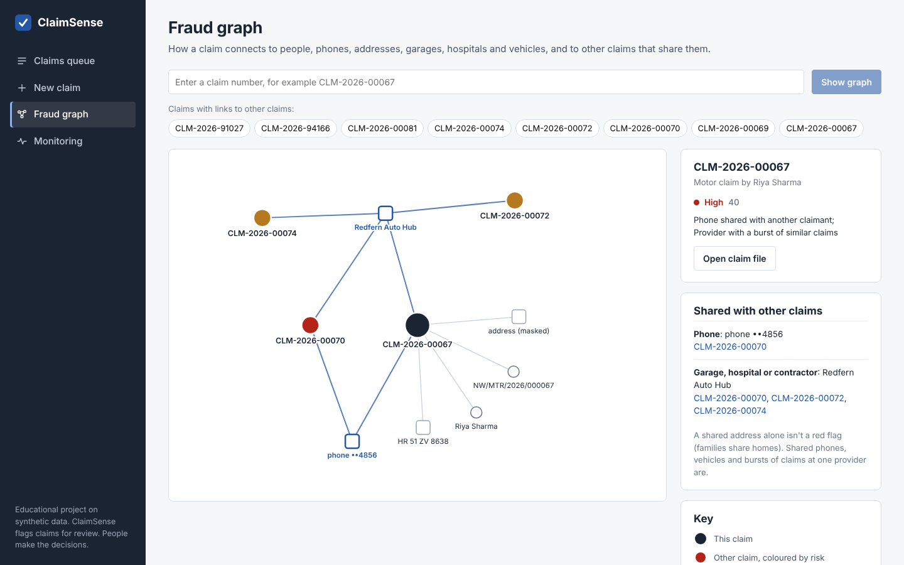
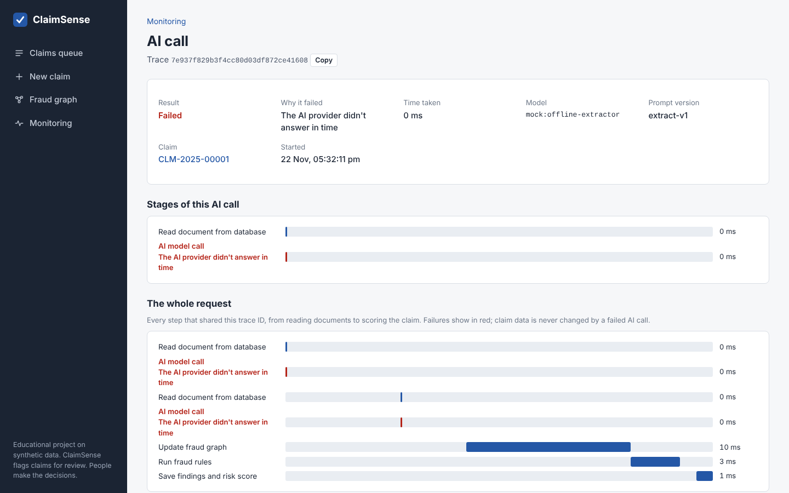

# ClaimSense: AI-Powered Insurance Claim Document Verification & Fraud Flagging

> Educational capstone project. **All policies, people and documents are synthetic.** ClaimSense flags claims
> for human review; it does not approve, reject or pay claims.

ClaimSense ingests claim documents, uses a hosted LLM to **extract** structured fields, then applies
**deterministic** validation and fraud rules, including a cross-claim relationship graph. Then **RAG** explains the
result: Azure AI Search retrieves the policy clauses behind each red flag (hybrid vector + keyword search), and the
model writes a short reviewer briefing grounded in those clauses, citing them as [GEN-2]. Every citation is checked
against what search returned; a briefing that cites anything else is withheld. Every AI call is traced, timed and logged.

**The AI reads and explains; it never scores or decides.** Risk scores come from rules, decisions from reviewers.

**Sign-in and roles.** Every API route needs a signed-in user (signed JWT, 8-hour expiry; salted PBKDF2 password
hashes; 5 failed attempts lock an account for 5 minutes). Intake staff create claims, upload and verify; claims
reviewers also record decisions and see the fraud graph and monitoring; admins can do everything. Decisions and the
audit trail use the identity from the token, never from the request. Demo accounts: `intake01`, `reviewer01`,
`admin01` (password from `DEMO_PASSWORD`). In production this would use the company's single sign-on (e.g. Microsoft
Entra ID) with roles from directory groups; the role checks stay the same.

**Stack:** React · FastAPI + Pydantic · PostgreSQL · Azure OpenAI (gpt-4.1-mini, text-embedding-3-small) · Azure AI Search · OpenTelemetry



## Architecture

Problem: [docs/problem_statement.md](docs/problem_statement.md) · Architecture: [docs/02-architecture.md](docs/02-architecture.md) · Plan: [docs/project_plan.md](docs/project_plan.md) · Design: [docs/01-day31-define-and-design.md](docs/01-day31-define-and-design.md) · Schema & rules: [docs/03-data-and-graph-schema.md](docs/03-data-and-graph-schema.md)

## Deployment

The training sandbox allows Container Registry and virtual machines (not App Service or managed PostgreSQL), so
ClaimSense is deployed as containers: the image is built and pushed to **Azure Container Registry** and runs on an
**Azure Linux VM** with PostgreSQL in a second container: [deploy/VM-DEPLOY.md](deploy/VM-DEPLOY.md).
On an unrestricted subscription, the App Service route applies: [deploy/DEPLOY.md](deploy/DEPLOY.md).
Containers: `docker compose -f docker-compose.full.yml up --build` (app + PostgreSQL on http://localhost:8080).
CI/CD: `.github/workflows/ci.yml` runs tests and the frontend build on every push; from `main` it builds and pushes
the image to the registry and rolls it out on the VM. Load test: `python -m app.load_test --url https://YOUR-APP.azurewebsites.net/api`.

## Repository layout
```
backend/
  app/
    main.py              FastAPI app, trace middleware
    config.py            env-based settings (no secrets in code)
    models.py            SQLAlchemy schema
    schemas.py           Pydantic request/response models
    observability.py     OpenTelemetry, JSON logs, stage recorder
    services/            ingestion · llm · extraction · graph · rules · pipeline
    routers/             claims · observability · graph
    datagen.py           synthetic dataset generator (real places, fictional people)
    seed.py              writes documents, answer key and scans; loads and processes claims
    evaluate.py          accuracy report against the answer key
  tests/                 pytest (rules + API, runs on SQLite)
data/sample_documents/   213 generated synthetic documents (+ scans/ for OCR)
data/ground_truth.json   answer key: expected rules per claim, true field values per document
docs/                    design, architecture, schema
sql/demo_queries.sql     SQL demonstrations
frontend/                React + Vite app (claims queue, claim file, new claim, fraud graph, monitoring)
```

## Quick start
```bash
docker compose up -d                       # PostgreSQL on :5432
cd backend
python -m venv .venv && source .venv/bin/activate   # Windows: .venv\Scripts\activate
pip install -r requirements.txt
cp ../.env.example .env                    # set LLM_PROVIDER / LLM_API_KEY for a live model
python -m app.seed                         # 84 synthetic claims, processed offline (fast)
uvicorn app.main:app --reload              # http://localhost:8000/docs
pytest -q
```
Start the frontend in a second terminal (needs Node.js 18+):
```bash
cd frontend
npm install
npm run dev                                # http://localhost:5173
```

Use the real model: set `LLM_PROVIDER=azure` plus the `AZURE_OPENAI_*` values in `backend/.env`
(or `LLM_PROVIDER=openai_compat` with `LLM_API_KEY`, `LLM_BASE_URL`, `LLM_MODEL` for Groq), then:
```bash
python -m app.seed --live --limit 15       # real AI on 15 claims (free-tier friendly), offline for the rest
python -m app.seed --live                  # real AI on every document (slow on free tiers)
python -m app.evaluate                     # accuracy vs the answer key -> docs/evaluation-report.md
```

RAG over policy wording (`data/policy_wording/`): set the `AZURE_SEARCH_*` values in `backend/.env`, then:
```bash
python -m app.rag_index                    # create the index, embed 18 clauses, upload, measure hit@1 / hit@3
python -m app.seed --live                  # also writes a grounded briefing for every flagged claim
python -m app.evaluate                     # includes briefing grounding, coverage and correct-clause rate
python -m app.rag_index --check            # accuracy check only -> docs/retrieval-report.md
```
Without Azure AI Search, retrieval falls back to local keyword search (the baseline in the report).

Scans and photos (`.png`, `.jpg`, scanned PDFs) are read by OCR before extraction. `OCR_PROVIDER=auto` uses Azure
Document Intelligence when `AZURE_DOCINTEL_*` is set, otherwise gpt-4.1-mini vision. Measure it on the 8 scans:
```bash
python -m app.scan_eval                    # scan -> OCR -> extraction vs the answer key -> docs/scan-report.md
```

Held-out stress test (never used for tuning): ~140 new claims at a realistic ~7% fraud rate, new names, messy
layouts (relabelled fields, typos, noise, lost line breaks), ~15% of documents as degraded scans, plus an OCR ladder
(the same documents at light/medium/heavy quality). Runs in its own SQLite file, so the main database is untouched:
```bash
python -m app.stress_test                  # live Azure, ~15 min -> docs/stress-report.md
python -m app.stress_test --offline        # plumbing check, no API calls
```

Demo failures: set `SIMULATE_FAILURE=timeout|quota|malformed|slow` and restart the API.

## API
| Method | Route | Purpose |
|---|---|---|
| GET | /health | status + active model |
| GET | /policies | list policies |
| GET | /claimants | list claimants |
| GET / POST | /claims | list (filter `status`, `risk_level`) / create claim |
| GET | /claims/{id} | claim with documents and findings |
| POST | /claims/{id}/documents | upload .txt/.pdf/.md (`doc_type` form field) |
| POST | /claims/{id}/process | extract → graph → rules → risk score (returns `trace_id`) |
| GET | /claims/{id}/extractions | AI-extracted fields per document |
| GET | /documents/{id} | document text |
| GET / POST | /claims/{id}/reviews | reviewer decisions / record clear, escalate or request info + AI rating |
| GET | /graph/claims/{id} | 2-hop relationship graph + shared identifiers |
| POST | /auth/login | sign in; returns a token (send as `Authorization: Bearer ...`) |
| GET | /auth/me | the signed-in user and role |
| GET | /claims/{id}/summary | AI reviewer briefing (RAG) with citations and suggested checks |
| GET | /policy/search | search the policy wording (RAG knowledge base) |
| GET | /policy/clauses | all policy clauses |
| GET | /observability/runs | AI runs (filter `status`, `model`, `hours`, `claim_id`) |
| GET | /observability/metrics | totals, error rate, p95 latency, alerts, reviewer feedback |
| GET | /observability/runs/{run_id} | stage events for one AI run |
| GET | /observability/traces/{trace_id} | all stages for one request |

## Dataset
84 synthetic claims and 213 documents set in real Indian cities, with fictional people, businesses and numbers.
About a third carry planted red flags (rings, reused invoices, inflated amounts, policy-period violations), and a
few contain innocent oddities that must not be flagged. Details: [docs/03-data-and-graph-schema.md](docs/03-data-and-graph-schema.md).

## Screens
| Claim file | Fraud graph |
|---|---|
|  |  |

Every AI call can be traced stage by stage:



## Safety & privacy
- API keys live only in `backend/.env`; the frontend never calls the model.
- Logs never contain document text, phone numbers, addresses or keys.
- The LLM only extracts fields. Risk scores come from rules, and decisions are made by humans.
- Retrieved policy clauses are evidence for the reviewer only; they never change a score. If search fails,
  the claim is still scored and the failure is logged.
- Phone numbers and addresses are masked in graph labels.
- Only a reviewer can move a claim out of NEEDS_REVIEW (clear, escalate or request information).

## Progress
| Day | Deliverable | Status |
|---|---|---|
| 31 | Define & design: problem, roles, MVP, stories, architecture, tech decisions, repo | ✅ |
| 32 | Backend & AI: schema, ingestion, extraction, validation, API foundation, 84-claim dataset + answer key | ✅ |
| 33 | Frontend & integration: 5 screens, reviewer decisions, error/empty states | ✅ |
| 34 | Deployment & testing | ⏳ |
