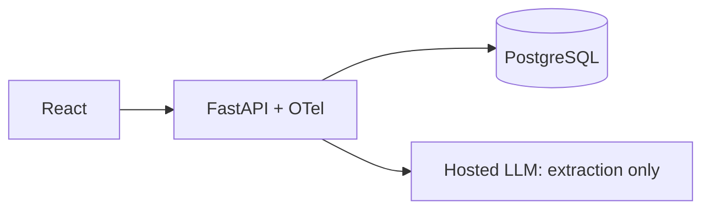

# ClaimSense: AI-Powered Insurance Claim Document Verification & Fraud Flagging

> Educational capstone project. **All policies, people and documents are synthetic.** ClaimSense flags claims
> for human review; it does not approve, reject or pay claims.

ClaimSense ingests claim documents, uses a hosted LLM to **extract** structured fields, then applies
**deterministic** validation and fraud rules, including a cross-claim relationship graph. Reviewers get a risk
score with evidence. Every AI call is traced, timed and logged.

**Stack:** React · FastAPI + Pydantic · PostgreSQL · Hosted LLM (Groq / Gemini, Option A) · OpenTelemetry

## Architecture

Details: [docs/02-architecture.md](docs/02-architecture.md) · Design: [docs/01-day31-define-and-design.md](docs/01-day31-define-and-design.md) · Schema & rules: [docs/03-data-and-graph-schema.md](docs/03-data-and-graph-schema.md)

## Repository layout
```
backend/
  app/
    main.py              FastAPI app, trace middleware
    config.py            env-based settings (no secrets in code)
    models.py            SQLAlchemy schema
    schemas.py           Pydantic request/response models
    observability.py     OpenTelemetry, JSON logs, stage recorder
    services/            ingestion · llm · extraction · graph · rules · pipeline
    routers/             claims · observability · graph
    seed.py              synthetic data generator
  tests/                 pytest (rules + API, runs on SQLite)
data/sample_documents/   generated synthetic documents
docs/                    design, architecture, schema
sql/demo_queries.sql     SQL demonstrations
frontend/                React app (Day 33)
```

## Quick start
```bash
docker compose up -d                       # PostgreSQL on :5432
cd backend
python -m venv .venv && source .venv/bin/activate   # Windows: .venv\Scripts\activate
pip install -r requirements.txt
cp ../.env.example .env                    # set LLM_PROVIDER / LLM_API_KEY for a live model
python -m app.seed                         # synthetic data + processing with mock extractor
uvicorn app.main:app --reload              # http://localhost:8000/docs
pytest -q
```
Use a real model: set `LLM_PROVIDER=openai_compat`, `LLM_API_KEY`, `LLM_BASE_URL`, `LLM_MODEL` in `backend/.env`,
then run `python -m app.seed --live`.

Demo failures: set `SIMULATE_FAILURE=timeout|quota|malformed|slow` and restart the API.

## API
| Method | Route | Purpose |
|---|---|---|
| GET | /health | status + active model |
| GET | /policies | list policies |
| GET / POST | /claims | list (filter `status`, `risk_level`) / create claim |
| GET | /claims/{id} | claim with documents and findings |
| POST | /claims/{id}/documents | upload .txt/.pdf/.md (`doc_type` form field) |
| POST | /claims/{id}/process | extract → graph → rules → risk score (returns `trace_id`) |
| GET | /claims/{id}/extractions | AI-extracted fields per document |
| GET | /graph/claims/{id} | 2-hop relationship graph + shared identifiers |
| GET | /observability/runs | AI runs (filter `status`, `model`, `hours`) |
| GET | /observability/metrics | totals, error rate, p95 latency, alerts |
| GET | /observability/runs/{run_id} | stage events for one AI run |
| GET | /observability/traces/{trace_id} | all stages for one request |

## Safety & privacy
- API keys live only in `backend/.env`; the frontend never calls the model.
- Logs never contain document text, phone numbers, addresses or keys.
- The LLM only extracts fields. Risk scores come from rules, and decisions are made by humans.
- Phone numbers and addresses are masked in graph labels.

## Progress
| Day | Deliverable | Status |
|---|---|---|
| 31 | Define & design: problem, roles, MVP, stories, architecture, tech decisions, repo | ✅ |
| 32 | Backend & AI: schema, ingestion, extraction, validation, API foundation | ✅ |
| 33 | Frontend & integration | ⏳ |
| 34+ | Reviews & feedback loop, dashboards, demo | ⏳ |
