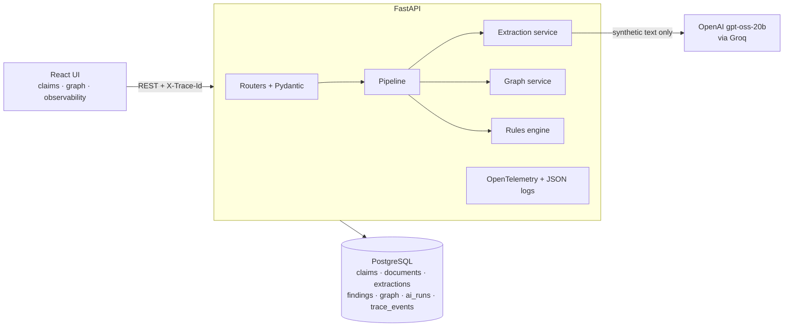
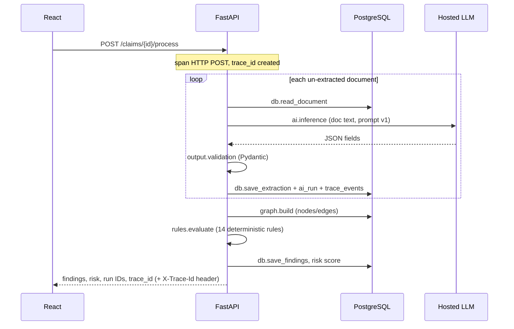

# Architecture

## Verification sequence (one trace ID throughout)

If the LLM times out, hits quota or returns junk, the run is stored as FAILED with an error category, and the
rules still run on whatever was extracted. Claim records are never modified by the AI step.
