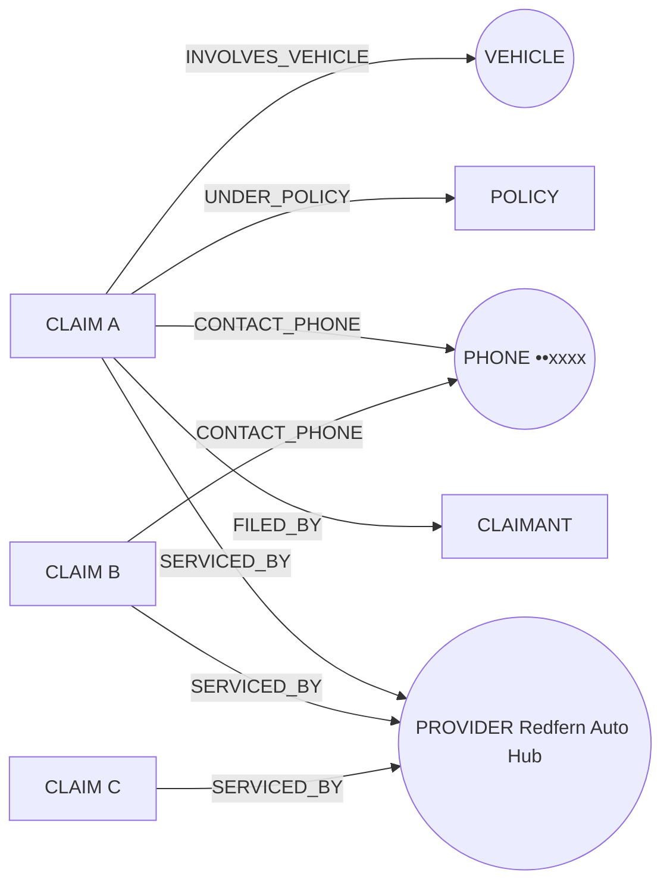

# Data & graph schema

## Tables
| Table | Purpose / key columns |
|---|---|
| policies | policy_number (unique), product_type MOTOR/HEALTH/PROPERTY, sum_insured, start/end dates |
| claimants | claimant_code, synthetic name, phone, address |
| claims | claim_number, FK policy & claimant, incident/reported dates, claimed_amount > 0, status, risk_score, risk_level |
| documents | FK claim, doc_type, filename, sha256 (duplicate detection), text_content |
| ai_runs | run_id (UUID), trace_id, model_id, prompt_version, status, latency_ms, error_type, tokens |
| extractions | FK document + run, fields (JSON, validated), is_valid |
| validation_findings | FK claim, rule_code, severity, message, evidence (JSON) |
| trace_events | trace_id, run_id (nullable), span_name, started_at, duration_ms, status, error_category |
| graph_nodes | node_type, node_key (normalized), label (masked for PII types) |
| graph_edges | src (always a CLAIM node), dst, relation |
| reviews | FK claim + run, decision CLEAR/ESCALATE/REQUEST_INFO, ai_helpful, comment |
| audit_events | actor, entity, action, timestamp |

All timestamps are stored in UTC.

## Graph model

Shared-identifier node types: PHONE, ADDRESS, PROVIDER, VEHICLE. Identifiers are normalized before matching
(phone = last 10 digits, vehicle = letters and digits only, provider = lower case without "Pvt Ltd"/"LLP" etc.).

## Rules (deterministic)
| Code | Severity | Fires when |
|---|---|---|
| POLICY_PERIOD | HIGH | incident outside policy dates |
| OVER_SUM_INSURED | HIGH | claimed > sum insured |
| POLICY_NUMBER_MISMATCH | HIGH | a document quotes a different policy number |
| DUPLICATE_DOCUMENT | HIGH | identical file (same SHA-256) on another claim |
| DUPLICATE_INVOICE | HIGH | same invoice number + provider on another claim |
| SHARED_VEHICLE | HIGH | the same vehicle appears on a claim by a different claimant |
| EARLY_CLAIM | MEDIUM | incident ≤ 30 days after policy start |
| AMOUNT_MISMATCH | MEDIUM | invoice/bill total differs > 10 % from claimed |
| NAME_MISMATCH | MEDIUM | a document names a different person (initials and capitals are tolerated) |
| DATE_MISMATCH | MEDIUM | a document states a different incident date |
| SHARED_PHONE | MEDIUM | the claimant's phone is also used by a different claimant |
| PROVIDER_CLUSTER | MEDIUM | the garage/hospital/contractor handled ≥ 2 other claims within 30 days |
| LATE_REPORTING | LOW | reported > 30 days after incident |
| MISSING_DOCUMENT | LOW | required doc type absent for the claim type |

Score = HIGH 40 + MEDIUM 20 + LOW 5 (capped at 100). LOW < 20 ≤ MEDIUM < 40 ≤ HIGH. MEDIUM and HIGH claims go to
NEEDS_REVIEW. A shared address alone is not flagged (families share addresses), and a busy garage is only flagged
when its claims cluster in time.

## Synthetic dataset
Generated by `backend/app/datagen.py` (fixed seed, so every run produces the same data).

- **84 claims** (motor, health, property), **213 documents**, 83 claimants, 84 policies, April 2025 – September 2026.
- **Real places, fictional people.** Real Indian cities, localities, PIN codes and RTO codes. People, house numbers,
  businesses, policies and amounts are fictional. Phones use the `+91 55xxx` range (not an Indian mobile range) and
  vehicles use a `Z*` test series. Every document says `SYNTHETIC TEST DOCUMENT - NOT A REAL RECORD`.
- **Varied, messy documents.** Three claim-form layouts (form, sectioned, letter), three motor-invoice layouts
  (GST tax invoice with line items, job card, receipt), two hospital-bill layouts (itemized bill, discharge
  summary), two police-report layouts (diary entry narrative, traffic report), two contractor-bill layouts. Dates,
  amounts (₹1,48,500.00 / Rs. 1,48,500/- / INR / Rs 148500.00) and names (full, capitals, initials) vary.
  Line items, 18 % GST and totals add up.
- **29 planted scenarios (~35 %)**: incident before policy start or after expiry, claims over the sum insured,
  inflated claims (motor, health, property), an exact reused invoice file, an edited invoice copy, a 4-claim garage
  ring in Faridabad, a 3-claim hospital ring in Lucknow sharing one phone, one vehicle claimed by two people, a
  hospital bill in another person's name, a wrong policy number, a police report with a different date, early
  claims, late reporting and missing documents.
- **Innocent oddities that must NOT be flagged**: a claim 5 % above its invoice (towing), a claim reported 20 days
  after discharge, family members sharing an address, and a repeat claimant on the same vehicle months later.
- **Answer key**: `data/ground_truth.json` lists, for every claim, the scenario, the rules that should fire and
  whether it should go to review, and for every document the field values actually written in it.
- **Scans**: 8 documents are also rendered as scanned-looking PNGs in `data/sample_documents/scans/` for the
  Document Intelligence (OCR) step.

The seed also forces one AI timeout so the observability dashboard has failure data.

## Evaluation
`python -m app.evaluate` compares the database with the answer key and writes `docs/evaluation-report.md`:
field-level extraction accuracy of the live model (including values it invented), per-rule precision and recall,
and how many claims were routed to review correctly.
