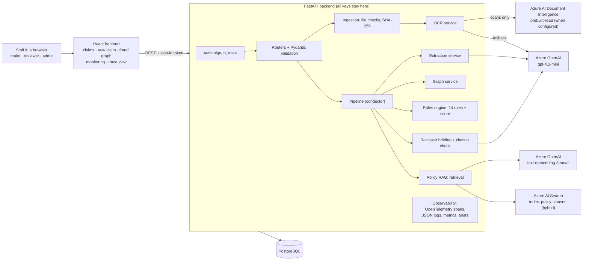
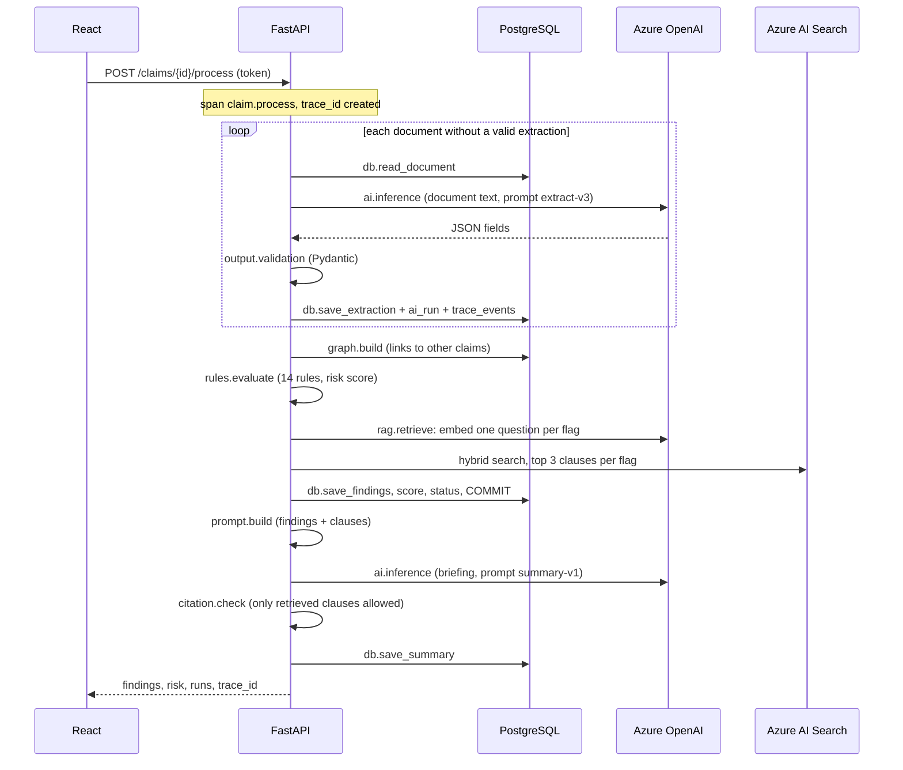

# ClaimSense: Architecture

**Core principle:** the AI reads and explains; plain code scores; a human decides. No AI output ever sets a risk
score or a claim decision.

## 1. Components

| Component | Responsibility | Code |
|---|---|---|
| React frontend | Screens for each role; shows flags, clauses, briefings, traces. Never calls Azure directly. | `frontend/src/` |
| Auth | Password check (salted PBKDF2), signed JWT (8 h), roles, lockout after 5 failures | `services/auth.py`, `routers/auth.py` |
| Routers + Pydantic | API endpoints; reject invalid input before it reaches the database | `routers/`, `schemas.py` |
| Ingestion | File type/size checks, SHA-256 fingerprint for duplicate detection, text extraction | `services/ingestion.py` |
| OCR | Scans and photos to text. Document Intelligence if configured, otherwise gpt-4.1-mini vision | `services/ocr.py` |
| Extraction | Prompt (v3) asks gpt-4.1-mini for 10 fields as JSON; Pydantic validates; every call recorded | `services/extraction.py`, `services/llm.py` |
| Graph | Links claims through shared phones, vehicles, addresses and providers | `services/graph.py` |
| Rules engine | 14 deterministic rules + advisory SCAN_UNCLEAR; HIGH 40 / MEDIUM 20 / LOW 5; review from 20 | `services/rules.py` |
| Policy RAG | Embeds a question per flag; hybrid search returns the top 3 clauses (filtered by product) | `services/policy_rag.py` |
| Reviewer briefing | Findings + retrieved clauses into a prompt; gpt-4.1-mini writes a cited briefing; citations verified | `services/reviewer_summary.py` |
| Pipeline | Runs the steps in order under one trace ID; commits scores before optional AI explanations | `services/pipeline.py` |
| Observability | Spans per stage (`trace_events`), JSONL logs, metrics (p95, error rate), alerts, failure simulation | `observability.py`, `routers/observability.py` |
| PostgreSQL | Claims, policies, claimants, documents, extractions, findings, graph, ai_runs, trace_events, reviewer_summaries, reviews, audit_events, users | `models.py` |

## 2. Verification sequence (one trace ID throughout)

Stage names below are the exact names shown in the trace view.

## 3. Upload sequence for scans

1. `POST /claims/{id}/documents` with an image or scanned PDF.
2. Ingestion validates the file and computes its SHA-256; no text layer, so it needs OCR.
3. `ocr.read`: Document Intelligence (`prebuilt-read`, submit then poll) or gpt-4.1-mini vision.
4. The OCR text is stored on the document with the engine used (`ocr_engine`); the OCR call is an `ai_run` (task OCR).
5. From here the document is processed exactly like a text document.

## 4. RAG indexing (one-time setup)

`python -m app.rag_index`: read `data/policy_wording/*.md` → split at each `## ID | Title` heading (18 clauses) →
embed each with `text-embedding-3-small` (1,536 dimensions) → upload text, vector and product tag to the
`policy-clauses` index (HNSW vector search plus keyword search) → measure hit@1 and hit@3 against an answer key.

## 5. Failure handling

| Failure | What happens |
|---|---|
| AI timeout, quota, bad JSON, invalid fields | Run stored as FAILED with an error category; rules still run on what was extracted; retried on next verification |
| OCR fails | Upload rejected with a clear message; failed OCR run kept for monitoring |
| AI Search or embeddings fail | Flags and score are still saved; clauses and briefing are skipped; error logged |
| Briefing cites a clause search did not return | Briefing rejected (`ungrounded_citation`), never shown |
| Database error | Nothing is committed half-way; the request fails safely |

Claim data is never modified by an AI step, and scores are committed before any optional AI explanation runs.

## 6. Security

- API keys only in the backend's `.env` (cloud: app settings); `.env` is git-ignored; `.env.example` has placeholders.
- Every route except `/health` and `/auth/login` needs a signed-in user. Decisions need the reviewer role; the
  fraud graph and monitoring need reviewer or admin.
- The reviewer's identity comes from the token, never from the request body. Audit events record who did what.
- Logs hold IDs, stages, timings and error categories, never keys, passwords or full documents.
- Production path: Microsoft Entra ID single sign-on with roles from directory groups.

## 7. Technology choices

| Layer | Choice | Why | Fallback |
|---|---|---|---|
| Frontend | React | Required stack; rich screens for graph and traces | — |
| Backend | FastAPI + Pydantic | Fast APIs, automatic validation and Swagger docs | — |
| Database | PostgreSQL | Relational integrity for claims, audit and telemetry | SQLite for tests and the stress test |
| Extraction / briefings | Azure OpenAI gpt-4.1-mini | Accurate structured JSON, low cost, existing Azure access | Groq (OpenAI-compatible) |
| OCR | Document Intelligence; gpt-4.1-mini vision | Purpose-built OCR with confidence scores; vision needs no extra resource | Switch with `OCR_PROVIDER` |
| Embeddings | text-embedding-3-small | OpenAI model (project rule), 1,536 dimensions, cheap | — |
| Vector store | Azure AI Search (hybrid) | Managed, Azure-native, vector + keyword in one query | Local keyword search |
| Tracing | OpenTelemetry | Industry standard; spans persisted to `trace_events` | — |
| Tests | Pytest | 41 automated tests, run in CI (GitHub Actions) | — |
| Hosting (planned) | Azure App Service, Static Web Apps, Azure Database for PostgreSQL | Same cloud as the AI services | Local demo |

LangChain was not needed: direct API calls keep every stage visible in the traces, which the brief allows.
