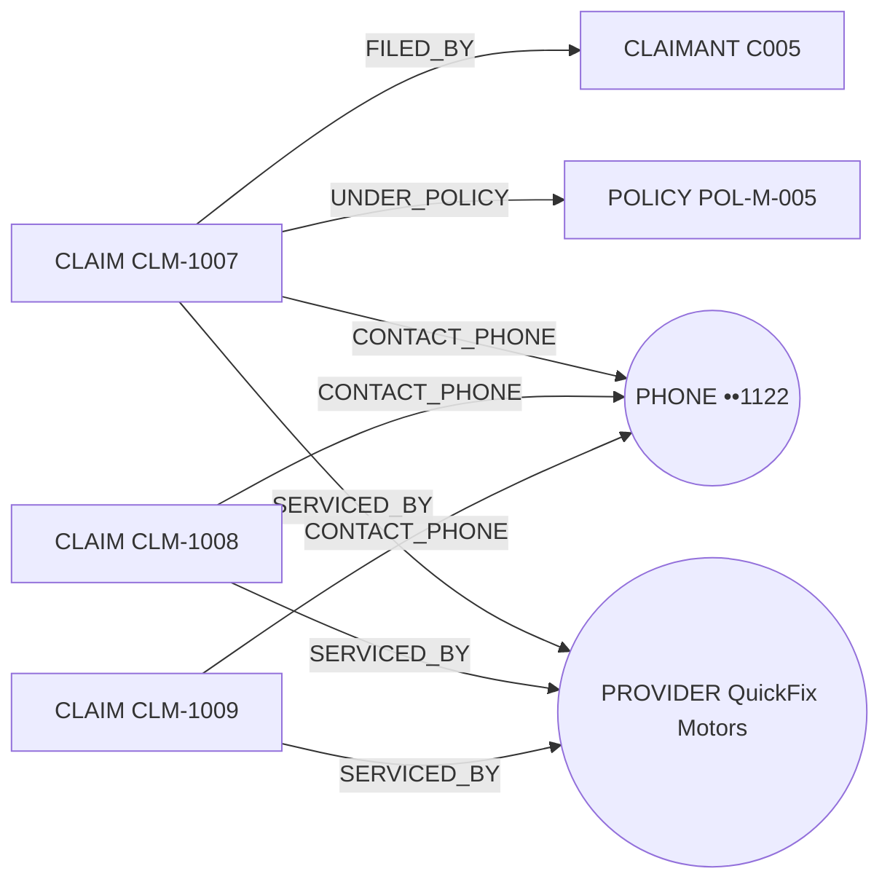

# Data & graph schema

## Tables
| Table | Purpose / key columns |
|---|---|
| policies | policy_number (unique), product_type MOTOR/HEALTH/PROPERTY, sum_insured, start/end dates |
| claimants | claimant_code, synthetic name, phone, address |
| claims | claim_number, FK policy & claimant, incident/reported dates, claimed_amount > 0, status, risk_score, risk_level |
| documents | FK claim, doc_type, filename, sha256 (duplicate detection), text_content |
| ai_runs | run_id (UUID), trace_id, model_id, prompt_version, status, latency_ms, error_type, tokens |
| extractions | FK document + run, fields (JSON, validated), is_valid |
| validation_findings | FK claim, rule_code, severity, message, evidence (JSON) |
| trace_events | trace_id, run_id (nullable), span_name, started_at, duration_ms, status, error_category |
| graph_nodes | node_type, node_key (normalized), label (masked for PII types) |
| graph_edges | src (always a CLAIM node), dst, relation |
| reviews | FK claim + run, decision CLEAR/ESCALATE/REQUEST_INFO, ai_helpful, comment |
| audit_events | actor, entity, action, timestamp |

All timestamps are stored in UTC.

## Graph model

Shared-identifier node types: PHONE, ADDRESS, PROVIDER, VEHICLE. If an identifier links a claim to 2 or more other
claims, the rule `SHARED_IDENTIFIER` fires.

## Rules (deterministic)
| Code | Severity | Fires when |
|---|---|---|
| POLICY_PERIOD | HIGH | incident outside policy dates |
| OVER_SUM_INSURED | HIGH | claimed > sum insured |
| POLICY_NUMBER_MISMATCH | HIGH | document policy number ≠ claim's |
| DUPLICATE_DOCUMENT | HIGH | same file hash on another claim |
| DUPLICATE_INVOICE | HIGH | same invoice no. + provider on another claim |
| EARLY_CLAIM | MEDIUM | incident ≤ 30 days after policy start |
| AMOUNT_MISMATCH | MEDIUM | invoice/bill total differs > 10 % from claimed |
| NAME_MISMATCH | MEDIUM | document name ≠ claimant |
| DATE_MISMATCH | MEDIUM | document incident date ≠ claim's |
| SHARED_IDENTIFIER | MEDIUM | identifier shared with ≥ 2 other claims |
| LATE_REPORTING | LOW | reported > 30 days after incident |
| MISSING_DOCUMENT | LOW | required doc type absent for claim type |

Score = HIGH 40 + MEDIUM 20 + LOW 5 (capped at 100). LOW < 20 ≤ MEDIUM < 40 ≤ HIGH.

## Seed dataset (synthetic)
11 policies, 11 claimants, 12 claims, 31 text documents. Each claim plants a scenario: clean, incident before
policy start, over sum insured, invoice mismatch, reused invoice file, a 3-claim ring sharing a phone and garage,
name mismatch, early + late reporting, missing invoice. The seed also forces two failed AI attempts (timeout,
malformed) so dashboards have failure data, which gives 35 AI runs in total.
